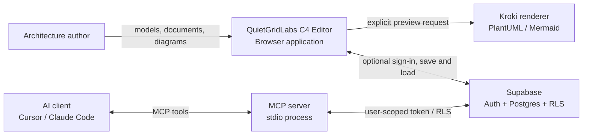
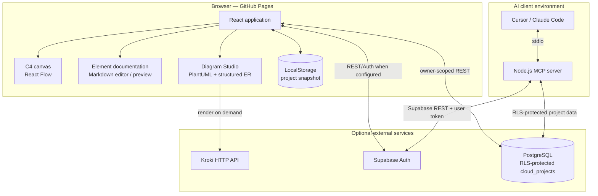
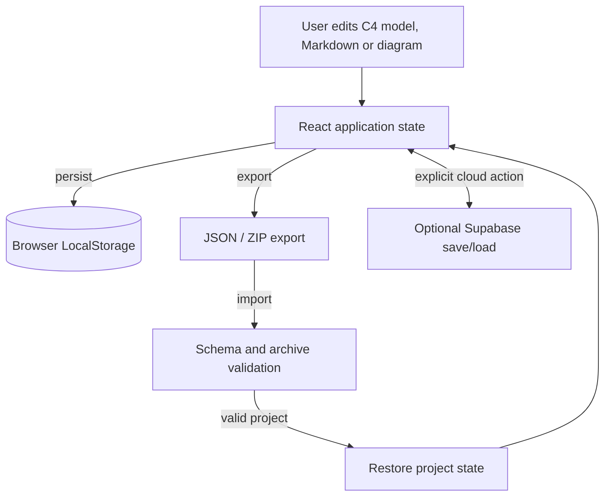

# Editor architecture

This document describes the architecture of QuietGridLabs C4 Editor itself.

## System context

## Container and runtime view

## Project data flow

## Trust and data boundaries

- The browser's LocalStorage is the default persistence layer; a cloud account is not required for local modeling and documentation.
- Diagram source is sent to Kroki only when the user explicitly requests a preview.
- Supabase is optional. Database Row Level Security enforces owner-scoped project access.
- The MCP server is a separate process. It uses a user-scoped access token and must not use a Supabase service-role key.
- JSON and ZIP imports are validated before the current project is replaced.

## Main implementation areas

| Area | Implementation |
|---|---|
| Browser application | React + Vite |
| C4 editing canvas | React Flow (@xyflow/react) |
| Element documentation | React Markdown + remark-gfm |
| Sequence and ER editor | src/DiagramStudio.jsx |
| Project schema and validation | src/projectSchema.js |
| ZIP backup and restore | src/projectBackup.js |
| Optional cloud workspace | src/CloudWorkspace.jsx, src/cloudClient.js |
| AI-client integration | mcp-server/ |
| Automated checks | tests/, GitHub Actions |

## Deployment model

The public browser application is built as static assets and deployed to GitHub Pages. The optional Supabase backend is a separate service and must be configured independently. GitHub Pages deployment does not provision Supabase or enable MCP connectivity by itself.
